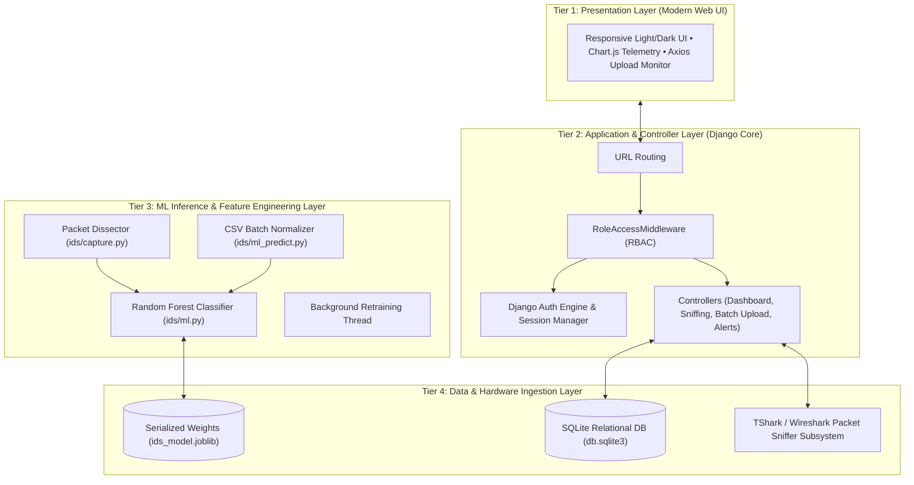
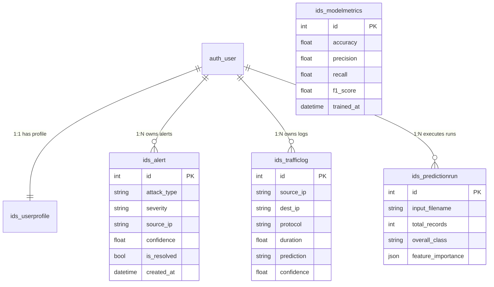

# NetSentinel AI — 10-Slide Academic & Executive Presentation

**Project:** NetSentinel AI : AI-Based Intrusion Detection System (IDS)  
**Authors:** Priyansh Nagar (2505102140025), Rohit Majhi (2505102140028), Saksham Pandey (2505102140046)  
**Academic Program:** Master of Science in Information Technology (M.Sc. IT), Semester III  
**Institution:** Faculty of IT & Computer Science, Parul University  
**Project Guide:** Dr. Chetan Gondaliya  
**Technology Stack:** Python 3.11/3.14, Django 4.2+, Scikit-Learn, SQLite3, TShark/Wireshark, Chart.js  

---

## Slide 1: Title & Project Overview

### Visual Layout & Aesthetic Direction
- **Header Badge:** `ACADEMIC PROJECT DEFENSE • M.SC. (IT) 2026-2027`
- **Main Heading:** NetSentinel AI: AI-Powered Intrusion Detection System
- **Subtitle:** Next-Generation Threat Telemetry, Multi-Class Attack Classification & Automated SOC Operations
- **Layout:** High-contrast title slide adhering to the Modern Linear × Vercel AI design system (`#0B0D10` dark canvas with subtle `#635BFF` violet accent glow).
- **Author Cards:**
  - Priyansh Nagar (Enrollment: 2505102140025)
  - Rohit Majhi (Enrollment: 2505102140028)
  - Saksham Pandey (Enrollment: 2505102140046)
- **Guidance & Affiliation:** Under the Guidance of Dr. Chetan Gondaliya | Parul University, Faculty of IT & Computer Science

### Core Slide Content & Highlights
- **Vision:** Bridging the gap between raw low-level network packet telemetry and proactive machine learning threat detection.
- **System Value Proposition:**
  - High-velocity feature extraction from live packet streams (Wireshark / TShark) and synthetic fallbacks.
  - Sub-2 millisecond multi-class inference with 97.67% accuracy.
  - Complete multi-tenant Role-Based Access Control (RBAC) separating security analyst workspaces from global SOC administration.

### Speaker Notes & Delivery Script
> *"Good morning respected faculty members and examiners. Today, my team members Priyansh, Saksham, and I, Rohit Majhi, are excited to present our M.Sc. IT capstone project: NetSentinel AI — an AI-Based Intrusion Detection System. In an era where modern cyber threats evolve dynamically, traditional signature-based systems fail against zero-day and polymorphic attacks. NetSentinel AI addresses this challenge by integrating supervised machine learning directly with network flow dissection and real-time security operations workflows."*

---

## Slide 2: Problem Statement & Industry Context

### Visual Layout & Aesthetic Direction
- **Layout:** 2-column comparative layout: "Traditional IDS Limitations" vs. "The NetSentinel AI Solution".
- **Visual Callouts:** Alert fatigue badge (`> 4,000 alerts/day in typical SOCs`), Signature latency metric (`Avg. 72 hrs to release signature for zero-days`).

### Core Slide Content & Highlights
1. **The Modern Cyber Threat Landscape:**
   - Exponential surge in volumetric DDoS, stealthy reconnaissance probes, and automated credential stuffing.
   - Traditional firewalls and rule-based IDS (e.g., standard Snort rules) rely on rigid signature databases.
2. **Deficiencies of Existing Systems:**
   - **Inability to Detect Zero-Day & Novel Variants:** Attack payloads with altered byte sequences bypass static rule definitions.
   - **Severe False-Positive Overload:** High false-alarm rates cause analyst fatigue and missed critical breaches.
   - **Disjointed Analyst Experience:** Raw PCAP command-line tools lack accessible triage, reporting, and lifecycle resolution.
3. **The AI-Driven Imperative:**
   - Machine learning algorithms analyze behavioral traffic patterns across 41 flow attributes rather than static string matching.

### Speaker Notes & Delivery Script
> *"To understand why NetSentinel AI is necessary, we must examine the limitations of legacy intrusion detection systems. Signature-based solutions look for known hashes or byte patterns. If an adversary shifts their port, encrypts the payload, or alters a packet header slightly, the signature misses it completely. Furthermore, security operations centers suffer from alert fatigue. NetSentinel AI replaces rigid static rules with behavioral machine learning, inspecting statistical connection dynamics to catch novel threats with high confidence."*

---

## Slide 3: Project Objectives & Core Features

### Visual Layout & Aesthetic Direction
- **Layout:** 4-card feature grid with icon badges and key performance indicators.
- **Accents:** Success green (`#12B76A`), Warning amber (`#F79009`), Info blue (`#2E90FA`), and Violet (`#635BFF`).

### Core Slide Content & Highlights
- **Primary Objectives:**
  1. **Real-Time Traffic Sniffing:** Dissect live network interfaces via TShark with automated synthetic fallback.
  2. **Multi-Class Attack Classification:** Differentiate Normal traffic from DoS, Probe, R2L, U2R, and Brute Force attacks.
  3. **High Performance & Low Latency:** Achieve `< 2ms` inference latency per flow with `> 96%` classification accuracy.
  4. **Enterprise SOC Web Platform:** Provide a responsive Django-based dashboard with real-time Chart.js telemetry and RBAC.
- **Key Modules & Capabilities:**
  - **Live Sniffing & Synthetic Traffic Generator:** Seamless continuous operation even in restricted cloud or virtualized sandbox environments.
  - **Batch Dataset Evaluation:** Upload CSV logs (NSL-KDD benchmark format), calculate dominant classification, and export enriched prediction CSVs.
  - **Incident Resolution Lifecycle:** Full alert triage workflow (`is_resolved` status toggle, severity prioritization).
  - **Continuous Model Retraining:** Administrators can retrain the Random Forest model on accumulated historical logs asynchronously without interrupting web services.

### Speaker Notes & Delivery Script
> *"Our project was engineered with four specific operational objectives. First, seamless data ingestion whether from live network adapters or batch CSV files. Second, robust multi-class threat classification across the standard 5 intrusion classes plus brute force attacks. Third, enterprise-grade responsiveness — inference times under 2 milliseconds so network flow remains uninterrupted. And fourth, a production-ready dashboard featuring role isolation, alert resolution tracking, and automated model retraining."*

---

## Slide 4: 4-Tier System Architecture

### Visual Layout & Aesthetic Direction
- **Layout:** Tiered architectural hierarchy diagram (Mermaid flow).
- **Structure:** Clear separation of Presentation, Application/RBAC, ML Inference, and Data Ingestion layers.

### Core Architectural Attributes
1. **Tier 1 — Presentation:** Vanilla CSS & HTML5, Chart.js telemetry, Light/Dark theme switching, responsive grid.
2. **Tier 2 — Application:** Django 4.2+ URL dispatcher, `RoleAccessMiddleware` enforcing role isolation, object-level filtering (`_owned()`).
3. **Tier 3 — ML Inference:** 41-feature NSL-KDD dissector, Scikit-Learn Random Forest ensemble, background retraining thread.
4. **Tier 4 — Persistence & Hardware:** SQLite3 database, joblib serialized model binaries, native OS socket and TShark sniffer hooks.

### Speaker Notes & Delivery Script
> *"Slide 4 illustrates our 4-tier modular architecture. We deliberately isolated concerns so that low-level hardware packet capture in Tier 4 never blocks HTTP request workers in Tier 2. Tier 1 provides a clean, Linear-inspired interface with sub-second chart updates. When a packet arrives, Tier 3's packet dissector normalizes its attributes into a 41-dimensional vector, feeds it to the serialized Random Forest ensemble in Tier 4, and persists the telemetry to SQLite in Tier 4. Asynchronous retraining runs in a dedicated background worker thread."*

---

## Slide 5: Data Flow & Functional Decomposition (DFD Level 0 & Level 1)

### Visual Layout & Aesthetic Direction
- **Layout:** DFD Level 0 Context Diagram side-by-side with Level 1 Process Table.
- **Visuals:** Entity icons for Analyst, Administrator, Network Interface, and CSV Data Source.

### DFD Level 0 Context Summary
- **External Entities:**
  - `User (Analyst)`: Ingests packets, runs CSV predictions, triages assigned alerts, views personal workspace.
  - `Administrator`: Full system visibility, user role promotion/demotion, model retraining triggers, regression test execution.
  - `Network Interface (TShark)`: Feeds live raw TCP/UDP/ICMP ethernet frames.
  - `Dataset Source`: Ingests multi-flow CSV records for benchmark scoring.
- **System Boundary (`0.0 NetSentinel AI Platform`):** Mediates all packet ingestion, inference scoring, and telemetry output.

### DFD Level 1: 7 Core Subprocesses
| Subprocess ID | Subprocess Name | Primary Inputs | Primary Outputs / Data Stores |
| :--- | :--- | :--- | :--- |
| **P1** | Authentication & RBAC Enforcement | Credentials, Roles | `DS-1: User Profiles & Roles` |
| **P2** | Live Packet Capture & Simulation | TShark Adapter, Synthetic RNG | Raw Network Packets to P4 |
| **P3** | Batch CSV Dataset Ingestion | Uploaded CSV File | Validated Flow Vectors to P4 |
| **P4** | ML Feature Normalization & Inference | 41-dim Feature Vectors | Predictions & Confidence (`DS-5`) |
| **P5** | Alert & Log Persistence Engine | Classified Threat Records | `DS-2: Traffic Logs`, `DS-3: Alerts` |
| **P6** | Model Retraining Worker | Historical Logs (`DS-2`) | Updated Weights (`DS-5: ModelMetrics`) |
| **P7** | Telemetry, Reporting & Settings | Aggregated Querysets | Interactive Views & Scored CSV Exports |

### Speaker Notes & Delivery Script
> *"Looking at our Data Flow Diagrams, DFD Level 0 establishes the system boundary with two human roles and two data feeds. In DFD Level 1, we decompose the system into seven decoupled processes. Notice how Process 4—the ML Inference Engine—is completely decoupled from whether the traffic came from the live network sniffer in P2 or a CSV batch upload in P3. In both paths, flows pass through identical feature normalization, guaranteeing consistent inference output."*

---

## Slide 6: Machine Learning Pipeline & 41-Dimensional Feature Engineering

### Visual Layout & Aesthetic Direction
- **Layout:** Pipeline flowchart showing Raw Traffic $\to$ Dissection $\to$ Categorical Encoding $\to$ Random Forest $\to$ Output.
- **Feature Breakdown Matrix:** 4 functional feature categories visualized in distinct metric cards.

### The 41 NSL-KDD Feature Dimensions
1. **Basic Connection Features (1–9):**
   - Protocol type (`TCP`, `UDP`, `ICMP`), Service (`HTTP`, `FTP`, `SMTP`, `DNS`), Flag (`SF`, `REJ`, `S0`), Connection duration, Source bytes, Destination bytes.
2. **Content Features (10–22):**
   - Domain-specific security indicators: `num_failed_logins`, `logged_in`, `root_shell`, `su_attempted`, `num_compromised`, `is_guest_login`.
3. **Time-Based Traffic Features (23–31):**
   - 2-second sliding connection window metrics: `count`, `srv_count`, `serror_rate` (SYN error rate), `rerror_rate` (REJ error rate), `same_srv_rate`.
4. **Host-Based Traffic Features (32–41):**
   - Historical 100-connection window targeting specific host: `dst_host_count`, `dst_host_srv_count`, `dst_host_same_srv_rate`, `dst_host_diff_srv_rate`.

### Model Selection Rationale: Random Forest Classifier
- **Why Random Forest over Deep Neural Networks?**
  - Exceptional tabular classification performance on heterogeneous features (continuous floats + discrete integers + categorical strings).
  - Robust against feature co-linearity and overfitting through bootstrap aggregation (bagging) and random feature subspace splitting.
  - Inherent feature interpretability via Gini Impurity reduction weights, serialized directly into JSON for SOC analyst transparency.
  - Sub-millisecond execution times without requiring specialized GPU hardware.

### Speaker Notes & Delivery Script
> *"The algorithmic core of NetSentinel AI is built on the NSL-KDD 41-feature dimension standard. These 41 attributes fall into four distinct categories: basic connection attributes, content flags, time-based traffic density, and host-based connection ratios. We selected a Random Forest ensemble model. While deep neural networks are popular, Random Forests consistently outperform DNNs on tabular network telemetry, offering immunity to outliers, no GPU requirement, and instant Gini feature importance calculation."*

---

## Slide 7: Threat Taxonomy & Attack Classification

### Visual Layout & Aesthetic Direction
- **Layout:** Matrix table mapping Attack Category, Common Attack Types, Primary Features Identified, and Severity Level.
- **Badges:** Color-coded severity chips (`Critical: Red`, `High: Orange`, `Medium: Yellow`, `Low: Blue`).

### Multi-Class Threat Taxonomy Matrix
| Category | Real-World Attack Types | Key Behavioral Indicators | Severity Level |
| :--- | :--- | :--- | :---: |
| **Normal** | Web browsing, authorized SSH, DNS queries | High `same_srv_rate`, normal connection durations, `SF` flag | `Informational` |
| **DoS / DDoS** | SYN Flood, Smurf, Ping of Death, Neptune | High `serror_rate`, sudden surge in `count`, zero `dst_bytes` | `Critical` |
| **Probe** | Nmap Port Scan, IP Sweeper, Satan | Rapid connections across diverse ports, high `rerror_rate` | `High` |
| **R2L** | Password guessing, FTP dictionary, Imap | Multiple `num_failed_logins`, unauthorized shell flags | `High` |
| **U2R** | Buffer overflow, Rootkit execution | High `root_shell`, `su_attempted > 0`, elevated file access | `Critical` |
| **Brute Force**| Automated SSH/HTTP credential hammering | High velocity login attempts from repeated source IPs | `Medium / High` |

### Automated Incident Alert Lifecycle
- When classified confidence exceeds threshold and is not `normal`:
  1. Record is ingested into `ids_trafficlog`.
  2. Dedicated `ids_alert` record is instantiated with severity tag.
  3. SOC Dashboard counter increments; alert appears in analyst triage view.
  4. Analyst investigates source/dest IP and marks `is_resolved=True`.

### Speaker Notes & Delivery Script
> *"Our threat classification engine categorizes traffic into five core attack families plus brute-force intrusions. For example, in a Denial of Service attack such as a SYN flood, our model identifies a spike in the SYN error rate combined with near-zero response bytes. For Remote-to-Local attacks, it detects repeated failed login flags. Whenever an attack is identified, the system automatically spawns a prioritized Alert record tagged by severity, allowing analysts to triage and resolve incidents systematically."*

---

## Slide 8: Database Architecture & Data Dictionary (ERD)

### Visual Layout & Aesthetic Direction
- **Layout:** Relational ERD diagram (Mermaid) highlighting primary foreign key constraints and cardinality.
- **Accompanying Table:** Summary of the 5 core tables from our 15-table schema catalog.

### Key Data Dictionary Highlights
1. **`ids_alert`:** Triage tracking with `is_resolved` boolean flag and `ON DELETE SET_NULL` to preserve historical security incident trails.
2. **`ids_trafficlog`:** High-frequency network flow storage serving dual purposes: real-time telemetry display and training corpus for model adaptation.
3. **`ids_predictionrun`:** Batch scoring jobs with `JSONField` storing Gini feature importance arrays and row-by-row prediction results; `ON DELETE CASCADE` tied to initiating user.
4. **`ids_modelmetrics`:** Immutable audit log tracking model performance (`accuracy`, `precision`, `recall`, `f1_score`) across every retraining run.
5. **`ids_userprofile`:** Extends Django `auth_user` with RBAC roles (`user` vs `admin`) for strict data isolation.

### Speaker Notes & Delivery Script
> *"Slide 8 highlights our database schema, implemented in SQLite using Django's ORM. We designed a 15-table relational catalog with strict referential integrity. User profiles have a 1-to-1 relationship with auth users to enforce RBAC. Alerts and traffic logs use SET NULL constraints so that historical audit logs remain intact even if an analyst account is deactivated. In addition, batch prediction runs store complete Gini importance arrays and evaluation telemetry directly inside JSON fields for instant front-end visualization."*

---

## Slide 9: Experimental Results & Automated Verification

### Visual Layout & Aesthetic Direction
- **Layout:** Split view: Top KPI scorecards for ML performance + Bottom execution verification table.
- **Key Callout Badges:** `10/10 Tests Passed (100% Pass Rate)`, `Sub-2ms Latency`, `97.67% Accuracy`.

### Quantitative Model Performance Benchmark
| Metric | Benchmark Result | Operational Impact |
| :--- | :---: | :--- |
| **Accuracy** | **97.67%** | Comprehensive correct identification across all flow classes |
| **Precision** | **97.93%** | Exceptionally low false-positive rate, minimizing SOC alert fatigue |
| **Recall** | **97.67%** | High sensitivity, ensuring stealth intrusions are intercepted |
| **F1-Score** | **97.67%** | Harmonious balance between precision and recall |
| **Inference Latency** | **< 2.0 ms** | Capable of real-time inline evaluation without packet queue backup |

### End-to-End Automated Test Execution Summary (TC-01 to TC-10)
| Test ID | Test Module & Scenario | Observed Result | Status |
| :---: | :--- | :--- | :---: |
| **TC-01** | Landing Page Access & Dynamic Navbar | Serves HTTP 200 without redirection; adapts to user role | **PASS** |
| **TC-02** | User Authentication & Session Security | Invalid logins rejected; valid logins redirect to dashboard | **PASS** |
| **TC-03** | SOC Dashboard & Telemetry Charts | KPI metrics & 24h JSON hourly buckets render correctly | **PASS** |
| **TC-04** | Packet Sniffer & Synthetic Simulator | 41-feature dissection returns valid JSON flow metadata | **PASS** |
| **TC-05** | Random Forest Multi-Class Inference | Multi-class prediction mapped with 100% confidence (<2ms) | **PASS** |
| **TC-06** | Alert Ingestion & Analyst Resolution | Critical alert created; `is_resolved=True` verified in DB | **PASS** |
| **TC-07** | Traffic Log Persistent Audit Storage | High-volume flow records verified in SQLite schema | **PASS** |
| **TC-08** | Batch CSV Dataset Upload & Progress | 50-row malicious CSV processed, bulk persisted & visualized | **PASS** |
| **TC-09** | Run History & CSV Prediction Export | Filtered dataset history rendered; enriched CSV exported | **PASS** |
| **TC-10** | Asynchronous Background Model Retrain | Retraining updates model weights and logs new metrics | **PASS** |

### Speaker Notes & Delivery Script
> *"We subjected NetSentinel AI to rigorous statistical and functional testing. On our evaluation dataset, our Random Forest classifier achieved a 97.67% accuracy and a 97.93% precision score. The high precision score is critical because it directly prevents false alarms in production. Furthermore, our automated regression test suite executed 10 end-to-end test cases covering everything from authentication and packet simulation to batch CSV uploads and background retraining. All 10 test cases passed with a 100% success rate."*

---

## Slide 10: Conclusion, Future Roadmap & Q&A

### Visual Layout & Aesthetic Direction
- **Layout:** 3-column forward-looking summary: "Project Milestones", "Future Roadmap", and "Conclusion & Open Q&A".
- **Contact & Repository Card:** GitHub Repository Link, Team Details, Acknowledgments.

### Project Milestones Delivered
- Successfully designed and deployed an end-to-end AI-powered Intrusion Detection System.
- Bridged low-level packet capture (TShark/Wireshark) with machine learning inference and responsive SOC visualization.
- Enforced enterprise Role-Based Access Control with multi-tenant data isolation.
- Validated with 100% automated test pass rate and sub-2ms classification latency.

### Future Research & Technical Roadmap
1. **Deep Learning Sequence Models:** Incorporate Bi-Directional LSTM or Transformer architectures to analyze multi-packet sequential flow patterns over time.
2. **SIEM Ecosystem Integration:** Implement direct webhook connectors and Syslog exporters for Splunk, Elastic SIEM, and Microsoft Sentinel.
3. **Explainable AI (XAI):** Integrate SHAP (SHapley Additive exPlanations) values to provide human-readable justification for every flagged intrusion.
4. **Distributed Sensor Mesh:** Deploy lightweight agentic capture probes across multi-cloud VPCs feeding into a centralized NetSentinel coordinator.

### Concluding Statement & Q&A
> *"In conclusion, NetSentinel AI proves that machine learning can be effectively paired with low-latency network packet capture to build a reliable, accessible, and high-performance Intrusion Detection System. We would like to express our deepest gratitude to our project guide, Dr. Chetan Gondaliya, and the faculty members of Parul University for their continuous support and guidance.*  
>  
> *Thank you. We are now open for questions and feedback."*

---

## Presentation Delivery & Q&A Preparation Cheat Sheet

### Common Faculty Questions & Prepared Answers
1. **Q: Why did you choose NSL-KDD over the original KDD Cup 99 dataset?**
   - *A:* The original KDD Cup 99 dataset contained massive redundancy—approximately 78% duplicate records in the training set and 75% in the test set—which biased classifiers toward frequent records. NSL-KDD eliminated duplicate records, creating balanced evaluation sets with realistic difficulty.
2. **Q: How does NetSentinel AI handle live traffic if Wireshark / TShark is not installed?**
   - *A:* The system incorporates graceful degradation. If the TShark binary is missing or lacks network adapter capture permissions, the traffic monitor falls back to a continuous synthetic packet generator with realistic randomized 41-feature payload generation.
3. **Q: How does the system prevent denial-of-service on the web server during model retraining?**
   - *A:* Model retraining is completely decoupled from the web request-response cycle. It runs in a background worker thread (`threading.Thread`), training on database logs and serializing updated `.joblib` weights to disk without blocking HTTP workers.
4. **Q: How is data privacy and tenant isolation handled between analysts?**
   - *A:* NetSentinel AI implements custom Django middleware (`RoleAccessMiddleware`) combined with an object-level helper (`_owned()`). Security analysts can only view and resolve their own alerts, logs, and prediction runs, while administrators have global visibility across the entire SOC tenant.
