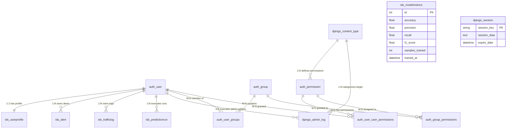

# NetSentinel AI — Comprehensive Database Data Dictionary

**System Name:** NetSentinel AI — AI-Powered Intrusion Detection System (IDS)  
**Database Engine:** SQLite 3 (Production Path: `db.sqlite3`)  
**ORM Framework:** Django 4.2+ (Python 3.11 / 3.14)  
**Schema Version:** 1.1.0 (RBAC & Multi-Tenant Data Ownership)  
**Last Updated:** 2026-10-14  

---

## 1. Schema Architecture & Entity Relationship Overview

NetSentinel AI employs an integrated relational schema comprising:
1. **Core IDS Domain Models (`ids` application):** Security alerts, real-time packet & simulated traffic logs, machine learning evaluation runs, model training performance metrics, and user profile role assignments.
2. **Authentication & Authorization (`django.contrib.auth`):** Core user credentials, role groups, and granular permissions.
3. **Session & System Administration (`django.contrib.*`):** Active user web sessions, administrative audit history, content-type registries, and migration audit trails.

---

## 2. Table Catalog

| # | Table Name | Django Model | Category | Primary Function |
|---|:---|:---|:---|:---|
| 1 | `ids_alert` | `Alert` | IDS Core | Stores high-priority security alerts generated by real-time sniffing, simulation, or batch predictions |
| 2 | `ids_trafficlog` | `TrafficLog` | IDS Core | Ingests granular network flow telemetry and ML classification results for traffic audit & model retraining |
| 3 | `ids_predictionrun` | `PredictionRun` | IDS Core | Preserves batch CSV dataset uploads, dominant classification outcome, feature importance, and row evaluation outputs |
| 4 | `ids_modelmetrics` | `ModelMetrics` | IDS Core | Tracks historical performance benchmarks (accuracy, precision, recall, F1) across training and retraining cycles |
| 5 | `ids_userprofile` | `UserProfile` | IDS Core / RBAC | Extends Django user model with system operational roles (`admin` or `user`) |
| 6 | `auth_user` | `User` | Auth / Security | Stores system user accounts, hashed credentials, and authentication flags |
| 7 | `auth_group` | `Group` | Auth / Security | Manages authorization role groups for team-based permissions |
| 8 | `auth_permission` | `Permission` | Auth / Security | Granular action-level permissions linked to application models |
| 9 | `auth_user_groups` | `User.groups` | Auth (Junction) | Many-to-many relationship mapping users to permission groups |
| 10 | `auth_user_user_permissions` | `User.user_permissions` | Auth (Junction) | Many-to-many mapping for direct custom permissions assigned to users |
| 11 | `auth_group_permissions` | `Group.permissions` | Auth (Junction) | Many-to-many mapping associating permission rules with groups |
| 12 | `django_session` | `Session` | System / Session | Server-side cryptographic HTTP session storage for authenticated analysts |
| 13 | `django_admin_log` | `LogEntry` | System / Audit | Historical audit log of actions performed via the administrative interface |
| 14 | `django_content_type` | `ContentType` | System / Registry | High-level metadata registry mapping models across installed Django apps |
| 15 | `django_migrations` | *(Internal)* | System / Schema | Tracks applied schema migrations for database version control |

---

## 3. Core IDS Domain Tables

### 3.1 Table: `ids_alert`
- **Django Model:** `ids.models.Alert`
- **Description:** Captures anomalous or hostile traffic identified by the Random Forest classifier that breaches threat thresholds. Supports analyst triage workflows and resolution lifecycle tracking.
- **Ordering:** Default descending by `created_at` (`ORDER BY created_at DESC`).

| Column Name | Data Type (SQLite / ORM) | Constraints & Keys | Description & Business Rules | Example |
|:---|:---|:---|:---|:---|
| `id` | `INTEGER` / `BigAutoField` | Primary Key, Auto-increment, Not Null | Unique synthetic surrogate identifier for the security alert record. | `1` |
| `attack_type` | `varchar(50)` / `CharField(50)` | Not Null | Attack taxonomy or category classified by the IDS. Common classifications include `dos`, `probe`, `r2l`, `u2r`, `brute_force`, and `normal`. | `'dos'` |
| `severity` | `varchar(20)` / `CharField(20)` | Not Null, Default: `'medium'` | Criticality level assigned for incident prioritization. Constrained to choices: `low`, `medium`, `high`, `critical`. | `'high'` |
| `source_ip` | `char(39)` / `GenericIPAddressField` | Not Null | Valid IPv4 or IPv6 network address originating the malicious traffic flow. | `'192.168.208.32'` |
| `dest_ip` | `char(39)` / `GenericIPAddressField` | Nullable, Blank: True | Valid IPv4 or IPv6 network address of the targeted internal or external host. | `'10.0.1.35'` |
| `confidence` | `REAL` / `FloatField` | Not Null, Default: `0.0` | Probability or confidence percentage score (0.0 to 100.0) generated by the Random Forest decision tree ensemble. | `96.0` |
| `is_resolved` | `bool` / `BooleanField` | Not Null, Default: `False` (`0`) | Workflow triage status flag indicating whether an analyst investigated and remediated the intrusion (`0` = Unresolved/Open, `1` = Resolved). | `0` |
| `created_at` | `datetime` / `DateTimeField` | Not Null, `auto_now_add=True` | UTC ISO-8601 timestamp automatically populated when the alert event is recorded. | `'2026-10-12 18:25:37.331418'` |
| `user_id` | `INTEGER` / `ForeignKey(User)` | Nullable, Foreign Key -> `auth_user(id)`, `ON DELETE SET_NULL` | Identifier of the security analyst who initiated the live capture or batch prediction session. Null for background system events. | `5` |

---

### 3.2 Table: `ids_trafficlog`
- **Django Model:** `ids.models.TrafficLog`
- **Description:** Stores individual network connection flows inspected by the NetSentinel engine (via live Wireshark/TShark sniffing, synthetic traffic generation, or socket polling). Serves as the raw audit log and training corpus for continuous model retraining.
- **Ordering:** Default descending by `created_at` (`ORDER BY created_at DESC`).

| Column Name | Data Type (SQLite / ORM) | Constraints & Keys | Description & Business Rules | Example |
|:---|:---|:---|:---|:---|
| `id` | `INTEGER` / `BigAutoField` | Primary Key, Auto-increment, Not Null | Unique surrogate key identifying each recorded network connection flow. | `1` |
| `source_ip` | `char(39)` / `GenericIPAddressField` | Not Null | Originating IPv4 or IPv6 host address for the connection. | `'192.168.75.189'` |
| `dest_ip` | `char(39)` / `GenericIPAddressField` | Not Null | Target destination IPv4 or IPv6 host address for the connection. | `'10.0.4.159'` |
| `protocol` | `varchar(10)` / `CharField(10)` | Not Null, Default: `'TCP'` | Network transport layer protocol identified in the packet header. Typically `TCP`, `UDP`, or `ICMP`. | `'ICMP'` |
| `duration` | `REAL` / `FloatField` | Not Null, Default: `0.0` | Total duration of the network connection or flow session expressed in seconds. | `29.9446` |
| `src_bytes` | `INTEGER` / `IntegerField` | Not Null, Default: `0` | Total volume of data payload transmitted from source to destination in bytes. | `2190` |
| `dst_bytes` | `INTEGER` / `IntegerField` | Not Null, Default: `0` | Total volume of data payload transmitted from destination to source in bytes. | `3121` |
| `prediction` | `varchar(50)` / `CharField(50)` | Not Null, Default: `'normal'` | Predictive security classification assigned by the ML model (`normal`, `dos`, `probe`, `r2l`, `u2r`, `brute_force`). | `'normal'` |
| `confidence` | `REAL` / `FloatField` | Not Null, Default: `0.0` | Confidence percentage (0.0 - 100.0) indicating model certainty regarding the predicted label. | `100.0` |
| `created_at` | `datetime` / `DateTimeField` | Not Null, `auto_now_add=True` | UTC ISO-8601 timestamp capturing the precise time of packet ingestion and scoring. | `'2026-10-12 18:25:37.288525'` |
| `user_id` | `INTEGER` / `ForeignKey(User)` | Nullable, Foreign Key -> `auth_user(id)`, `ON DELETE SET_NULL` | References the user account executing the monitoring session. Null for automated daemon logging. | `3` |

---

### 3.3 Table: `ids_predictionrun`
- **Django Model:** `ids.models.PredictionRun`
- **Description:** Records batch dataset scoring operations when analysts upload CSV files containing multi-flow records (e.g. NSL-KDD benchmark data). Stores aggregate statistics, feature importance weights, and full row-level evaluation arrays in JSON format.
- **Ordering:** Default descending by `created_at` (`ORDER BY created_at DESC`).

| Column Name | Data Type (SQLite / ORM) | Constraints & Keys | Description & Business Rules | Example |
|:---|:---|:---|:---|:---|
| `id` | `INTEGER` / `BigAutoField` | Primary Key, Auto-increment, Not Null | Unique identifier for each batch prediction run. | `1` |
| `input_filename` | `varchar(255)` / `CharField(255)` | Not Null | Sanitized base filename of the CSV document submitted by the analyst. | `'network_traffic (1).csv'` |
| `total_records` | `integer unsigned` / `PositiveIntegerField` | Not Null, Default: `0` | Total count of validated network flow rows evaluated in the uploaded file. | `15` |
| `overall_class` | `varchar(20)` / `CharField(20)` | Not Null | Dominant binary outcome classification for the entire batch. Choices: `malicious` or `normal`. | `'malicious'` |
| `confidence_score` | `REAL` / `FloatField` | Not Null | Dominant class percentage (0.0 to 100.0) representing aggregate threat density. | `73.3` |
| `malicious_percent` | `REAL` / `FloatField` | Not Null, Default: `0.0` | Proportion of evaluated flow rows classified as malicious threats (0.0 to 100.0). | `73.3` |
| `normal_percent` | `REAL` / `FloatField` | Not Null, Default: `0.0` | Proportion of evaluated flow rows classified as benign network traffic (0.0 to 100.0). | `26.7` |
| `model_name` | `varchar(64)` / `CharField(64)` | Not Null, Default: `'Random Forest'` | Architecture designation of the machine learning classifier utilized for inference. | `'Random Forest'` |
| `feature_importance` | `TEXT` / `JSONField` | Not Null, Default: `[]` | Serialized JSON array of top contributing features and their relative Gini importance weights. | `[{"label": "Packet Length", "value": 0.12}, {"label": "Flow Duration", "value": 0.12}]` |
| `traffic_summary` | `TEXT` / `JSONField` | Not Null, Default: `{}` | Serialized JSON object summarizing mean flow duration, packet sizes, protocol breakdown, and connection flags. | `{"flow_duration_ms": 133.7, "packet_length_bytes": 562, "protocol": "TCP", "connection_state": "SYN"}` |
| `results` | `TEXT` / `JSONField` | Not Null, Default: `[]` | Serialized JSON array of row-by-row prediction results containing source IP, dest IP, protocol, length, duration, prediction, and confidence. | `[{"source_ip": "192.168.1.10", "dest_ip": "172.16.0.5", "protocol": "TCP", "prediction": "Malicious", "confidence": 41.9}]` |
| `created_at` | `datetime` / `DateTimeField` | Not Null, `auto_now_add=True` | Timestamp when the dataset ingestion and scoring pipeline concluded. | `'2026-10-12 19:05:42.378071'` |
| `user_id` | `INTEGER` / `ForeignKey(User)` | Not Null, Foreign Key -> `auth_user(id)`, `ON DELETE CASCADE` | Identifier of the authenticated analyst who uploaded the dataset. Cascade deletion purges associated run history. | `5` |

---

### 3.4 Table: `ids_modelmetrics`
- **Django Model:** `ids.models.ModelMetrics`
- **Description:** Historical time-series repository tracking the statistical efficacy of the Random Forest model across baseline training and subsequent administrator-triggered retraining passes.
- **Ordering:** Default descending by `trained_at` (`ORDER BY trained_at DESC`).

| Column Name | Data Type (SQLite / ORM) | Constraints & Keys | Description & Business Rules | Example |
|:---|:---|:---|:---|:---|
| `id` | `INTEGER` / `BigAutoField` | Primary Key, Auto-increment, Not Null | Unique record identifier for the training performance log. | `1` |
| `accuracy` | `REAL` / `FloatField` | Not Null | Ratio of total correct predictions (benign and malicious) to total evaluation samples (0.0 to 1.0). | `0.9767` *(97.67%)* |
| `precision` | `REAL` / `FloatField` | Not Null | Weighted precision ratio measuring proportion of true intrusions among all flagged attacks (0.0 to 1.0). Minimizes false positives. | `0.9793` *(97.93%)* |
| `recall` | `REAL` / `FloatField` | Not Null | Weighted recall ratio measuring proportion of true intrusions correctly intercepted (0.0 to 1.0). Minimizes false negatives. | `0.9767` *(97.67%)* |
| `f1_score` | `REAL` / `FloatField` | Not Null | Harmonic mean balancing precision and recall ($2 \times \frac{P \times R}{P + R}$) on a scale from 0.0 to 1.0. | `0.9766` *(97.66%)* |
| `samples_trained` | `INTEGER` / `IntegerField` | Not Null, Default: `0` | Total count of network flow sample records incorporated into the training/retraining dataset corpus. | `2400` |
| `trained_at` | `datetime` / `DateTimeField` | Not Null, `auto_now_add=True` | Timestamp when model weights and encoders were fitted and serialized to disk (`ids_model.joblib`). | `'2026-10-12 18:25:37.235084'` |

---

### 3.5 Table: `ids_userprofile`
- **Django Model:** `ids.models.UserProfile`
- **Description:** One-to-one extension to Django's standard `auth_user` model, implementing NetSentinel AI's Role-Based Access Control (RBAC) architecture.
- **Business Rules:** Standard users receive role `'user'`; administrators receive role `'admin'`. Enforced by `RoleAccessMiddleware`.

| Column Name | Data Type (SQLite / ORM) | Constraints & Keys | Description & Business Rules | Example |
|:---|:---|:---|:---|:---|
| `id` | `INTEGER` / `BigAutoField` | Primary Key, Auto-increment, Not Null | Unique profile record identifier. | `1` |
| `user_id` | `INTEGER` / `OneToOneField(User)` | Not Null, Unique, Foreign Key -> `auth_user(id)`, `ON DELETE CASCADE` | 1-to-1 link to the parent user credentials in `auth_user`. Each user has exactly one profile. | `1` |
| `role` | `varchar(20)` / `CharField(20)` | Not Null, Default: `'user'` | Operational authorization tier. Choices: `admin` (SOC Lead with global visibility, retraining, and user management) or `user` (Analyst with workspace-scoped visibility). | `'admin'` |

---

## 4. Authentication & Authorization Tables

### 4.1 Table: `auth_user`
- **Django Model:** `django.contrib.auth.models.User`
- **Description:** Central authentication table containing user identity records, salted PBKDF2 password hashes, and system access flags.

| Column Name | Data Type (SQLite / ORM) | Constraints & Keys | Description & Business Rules | Example |
|:---|:---|:---|:---|:---|
| `id` | `INTEGER` / `BigAutoField` | Primary Key, Auto-increment, Not Null | Unique synthetic integer primary key identifying each registered analyst or administrator. | `1` |
| `password` | `varchar(128)` / `CharField(128)` | Not Null | Cryptographic password hash string formatted as `<algorithm>$<iterations>$<salt>$<hash>`. Never stored in plaintext. | `'pbkdf2_sha256$600000$FJgGmfDy9fX4QR4LcQXZ8x$F91KZ7SIRQkx8iwUIMNdyxIAfzsyJqnXwGZQ+e+plkU='` |
| `last_login` | `datetime` / `DateTimeField` | Nullable | UTC timestamp of the user's most recent successful session authentication. Null for new users before initial login. | `'2026-10-13 08:21:12.105088'` |
| `is_superuser` | `bool` / `BooleanField` | Not Null, Default: `False` (`0`) | Boolean administrative flag. When `1` (True), grants all system permissions without explicit assignment. | `1` |
| `username` | `varchar(150)` / `CharField(150)` | Not Null, Unique | Alphanumeric unique identifier used to log in. Max 150 characters. | `'admin'` |
| `first_name` | `varchar(150)` / `CharField(150)` | Not Null, Blank: True | Given first name of the user. Optional. | `'Rohit'` |
| `last_name` | `varchar(150)` / `CharField(150)` | Not Null, Blank: True | Family / surname of the user. Optional. | `'Majhi'` |
| `email` | `varchar(254)` / `EmailField` | Not Null, Blank: True | Primary contact email address used for notifications and account identity. | `'admin@netsentinel.local'` |
| `is_staff` | `bool` / `BooleanField` | Not Null, Default: `False` (`0`) | Access permission flag controlling whether the account can log into the Django administrative interface at `/admin/`. | `1` |
| `is_active` | `bool` / `BooleanField` | Not Null, Default: `True` (`1`) | Soft-delete and security lock flag. Inactive accounts (`0`) are prohibited from authenticating. | `1` |
| `date_joined` | `datetime` / `DateTimeField` | Not Null | UTC timestamp recording account creation date and time. | `'2026-10-12 18:26:15.472142'` |

---

### 4.2 Table: `auth_group`
- **Django Model:** `django.contrib.auth.models.Group`
- **Description:** Defines named authorization groups (e.g. "Incident Responders", "Tier 2 SOC") allowing batch assignment of permissions to sets of users.

| Column Name | Data Type (SQLite / ORM) | Constraints & Keys | Description & Business Rules | Example |
|:---|:---|:---|:---|:---|
| `id` | `INTEGER` / `BigAutoField` | Primary Key, Auto-increment, Not Null | Unique identifier for the permission group. | `1` |
| `name` | `varchar(150)` / `CharField(150)` | Not Null, Unique | Unique, human-readable name of the security or organizational group. | `'Security_Analysts'` |

---

### 4.3 Table: `auth_permission`
- **Django Model:** `django.contrib.auth.models.Permission`
- **Description:** Declares granular model-level permissions (such as add, change, delete, and view permissions) generated automatically by Django for each installed application entity.

| Column Name | Data Type (SQLite / ORM) | Constraints & Keys | Description & Business Rules | Example |
|:---|:---|:---|:---|:---|
| `id` | `INTEGER` / `BigAutoField` | Primary Key, Auto-increment, Not Null | Unique identifier for the individual permission rule. | `1` |
| `content_type_id` | `INTEGER` / `ForeignKey(ContentType)` | Not Null, Foreign Key -> `django_content_type(id)`, `ON DELETE CASCADE` | References the specific model entity in `django_content_type` to which the permission rule applies. | `1` |
| `codename` | `varchar(100)` / `CharField(100)` | Not Null | Technical machine identifier used in programmatic authorization checks (e.g., `@permission_required`). | `'add_alert'` |
| `name` | `varchar(255)` / `CharField(255)` | Not Null | Descriptive title of the permission displayed in administrative consoles. | `'Can add alert'` |

---

### 4.4 Table: `auth_user_groups`
- **Django Model:** `User.groups.through` (Many-to-Many Junction)
- **Description:** Junction table mapping many-to-many associations between users and authorization groups.

| Column Name | Data Type (SQLite / ORM) | Constraints & Keys | Description & Business Rules | Example |
|:---|:---|:---|:---|:---|
| `id` | `INTEGER` / `BigAutoField` | Primary Key, Auto-increment, Not Null | Unique junction record identifier. | `1` |
| `user_id` | `INTEGER` / `ForeignKey(User)` | Not Null, Foreign Key -> `auth_user(id)`, `ON DELETE CASCADE` | Identifier of the assigned user. | `3` |
| `group_id` | `INTEGER` / `ForeignKey(Group)` | Not Null, Foreign Key -> `auth_group(id)`, `ON DELETE CASCADE` | Identifier of the assigned authorization group. | `1` |

---

### 4.5 Table: `auth_user_user_permissions`
- **Django Model:** `User.user_permissions.through` (Many-to-Many Junction)
- **Description:** Junction table mapping direct, specific permissions granted to individual users outside of group membership.

| Column Name | Data Type (SQLite / ORM) | Constraints & Keys | Description & Business Rules | Example |
|:---|:---|:---|:---|:---|
| `id` | `INTEGER` / `BigAutoField` | Primary Key, Auto-increment, Not Null | Unique junction record identifier. | `1` |
| `user_id` | `INTEGER` / `ForeignKey(User)` | Not Null, Foreign Key -> `auth_user(id)`, `ON DELETE CASCADE` | References the user account receiving custom privileges. | `2` |
| `permission_id` | `INTEGER` / `ForeignKey(Permission)` | Not Null, Foreign Key -> `auth_permission(id)`, `ON DELETE CASCADE` | References the discrete permission granted to the user. | `18` |

---

### 4.6 Table: `auth_group_permissions`
- **Django Model:** `Group.permissions.through` (Many-to-Many Junction)
- **Description:** Junction table mapping permission capabilities assigned collectively to an authorization group.

| Column Name | Data Type (SQLite / ORM) | Constraints & Keys | Description & Business Rules | Example |
|:---|:---|:---|:---|:---|
| `id` | `INTEGER` / `BigAutoField` | Primary Key, Auto-increment, Not Null | Unique junction record identifier. | `1` |
| `group_id` | `INTEGER` / `ForeignKey(Group)` | Not Null, Foreign Key -> `auth_group(id)`, `ON DELETE CASCADE` | References the target authorization group. | `1` |
| `permission_id` | `INTEGER` / `ForeignKey(Permission)` | Not Null, Foreign Key -> `auth_permission(id)`, `ON DELETE CASCADE` | References the permission granted to all group members. | `24` |

---

## 5. System Administration & Session Tables

### 5.1 Table: `django_session`
- **Django Model:** `django.contrib.sessions.models.Session`
- **Description:** Stores server-side session dictionaries for authenticated users. The client browser holds an encrypted cookie `sessionid` referencing `session_key`.

| Column Name | Data Type (SQLite / ORM) | Constraints & Keys | Description & Business Rules | Example |
|:---|:---|:---|:---|:---|
| `session_key` | `varchar(40)` / `CharField(40)` | Primary Key, Not Null | 32-character random string acting as the public session lookup token. | `'sw41knxykyxof7i29usith9cmxygy9vl'` |
| `session_data` | `TEXT` / `TextField` | Not Null | Serialized, base64-encoded, and cryptographically signed payload storing session state (e.g. `_auth_user_id`, `_auth_user_backend`, `_auth_user_hash`). | `'.eJxVjEEOwiAQAP-yZ0NKQQo9eu8bml12kaqBpLQn499Nkx70...:1xGKof:...'` |
| `expire_date` | `datetime` / `DateTimeField` | Not Null, Index: True | Timestamp after which the session expires and the analyst must re-authenticate. | `'2026-10-26 18:32:05.382790'` |

---

### 5.2 Table: `django_admin_log`
- **Django Model:** `django.contrib.admin.models.LogEntry`
- **Description:** Security audit trail automatically logging creation, modification, and deletion operations executed through the `/admin/` portal.

| Column Name | Data Type (SQLite / ORM) | Constraints & Keys | Description & Business Rules | Example |
|:---|:---|:---|:---|:---|
| `id` | `INTEGER` / `BigAutoField` | Primary Key, Auto-increment, Not Null | Unique surrogate key for the administrative audit entry. | `1` |
| `object_id` | `TEXT` / `TextField` | Nullable | Primary key value of the database entity being modified, stored as text. | `'5'` |
| `object_repr` | `varchar(200)` / `CharField(200)` | Not Null | String representation (`__str__`) of the affected model instance at the time of modification. | `'network_traffic (1).csv (malicious)'` |
| `action_flag` | `smallint unsigned` / `PositiveSmallIntegerField` | Not Null | Numeric action code: `1` = Addition (Create), `2` = Modification (Update), `3` = Deletion (Delete). | `2` |
| `change_message` | `TEXT` / `TextField` | Not Null | JSON or formatted string detailing modified attributes and field deltas. | `'[{"changed": {"fields": ["is_resolved"]}}]'` |
| `content_type_id` | `INTEGER` / `ForeignKey(ContentType)` | Nullable, Foreign Key -> `django_content_type(id)`, `ON DELETE SET_NULL` | Identifies the table/model type of the modified entity. | `7` |
| `user_id` | `INTEGER` / `ForeignKey(User)` | Not Null, Foreign Key -> `auth_user(id)`, `ON DELETE CASCADE` | Identifier of the administrator account that performed the action. | `1` |
| `action_time` | `datetime` / `DateTimeField` | Not Null, `auto_now=True` | UTC timestamp when the administrative modification was executed. | `'2026-10-12 19:10:15.120450'` |

---

### 5.3 Table: `django_content_type`
- **Django Model:** `django.contrib.contenttypes.models.ContentType`
- **Description:** Meta-registry of all models registered across all installed applications, enabling generic foreign keys and permission links.

| Column Name | Data Type (SQLite / ORM) | Constraints & Keys | Description & Business Rules | Example |
|:---|:---|:---|:---|:---|
| `id` | `INTEGER` / `BigAutoField` | Primary Key, Auto-increment, Not Null | Unique identifier for each registered application model. | `7` |
| `app_label` | `varchar(100)` / `CharField(100)` | Not Null, Composite Unique with `model` | Package name of the owning Django application (e.g. `ids`, `auth`, `admin`). | `'ids'` |
| `model` | `varchar(100)` / `CharField(100)` | Not Null, Composite Unique with `app_label` | Lowercase class name of the registered model (e.g. `alert`, `trafficlog`, `predictionrun`). | `'alert'` |

---

### 5.4 Table: `django_migrations`
- **Django Model:** *(Internal Migration Framework)*
- **Description:** Internal system table recording every schema migration file that has been applied to this SQLite database.

| Column Name | Data Type (SQLite / ORM) | Constraints & Keys | Description & Business Rules | Example |
|:---|:---|:---|:---|:---|
| `id` | `INTEGER` / `BigAutoField` | Primary Key, Auto-increment, Not Null | Unique migration execution sequence identifier. | `1` |
| `app` | `varchar(255)` / `CharField(255)` | Not Null | Application name owning the migration file. | `'ids'` |
| `name` | `varchar(255)` / `CharField(255)` | Not Null | Name of the migration script executed (excluding `.py`). | `'0001_initial'` |
| `applied` | `datetime` / `DateTimeField` | Not Null | Precise UTC timestamp when the migration SQL transaction was committed. | `'2026-10-12 18:24:05.952748'` |

---

## 6. Model Field Mappings & Choice Constants Quick Reference

### Attack Type Classifications (`ids_alert.attack_type`, `ids_trafficlog.prediction`)
- `normal`: Benign network flow without hostile signatures.
- `dos`: Denial of Service attack (e.g., SYN Flood, Smurf, Ping of Death).
- `probe`: Surveillance and scanning probes (e.g., Port Scan, Nmap, IP Sweep).
- `r2l`: Remote to Local unauthorized access attempt (e.g., password guessing, Guess_Password).
- `u2r`: User to Root privilege escalation attempt (e.g., buffer overflow, Rootkit).
- `brute_force`: Repeated automated authentication attempts.

### Alert Severities (`ids_alert.severity`)
- `low`: Informational or minor deviations.
- `medium`: Suspicious anomalies requiring review (Default).
- `high`: Verified hostile behavior with potential compromise.
- `critical`: High-impact active exploitation or major DoS attack.

### User Roles (`ids_userprofile.role`)
- `admin`: SOC Administrator with full cross-tenant visibility, model retraining authority, and user governance.
- `user`: Standard Security Analyst with workspace-restricted visibility into owned logs, alerts, and prediction runs.

### Prediction Run Outcome (`ids_predictionrun.overall_class`)
- `malicious`: Batch contains majority/critical malicious threat vectors.
- `normal`: Batch predominantly characterized by benign network traffic.
