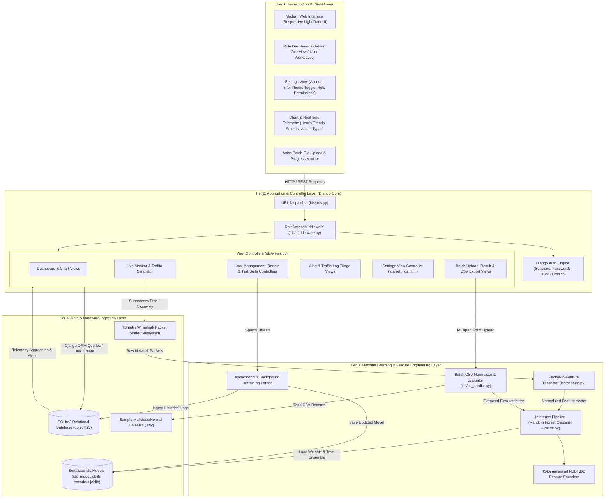
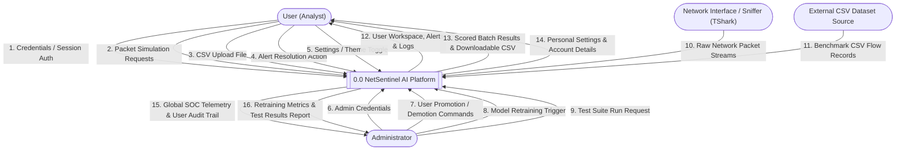
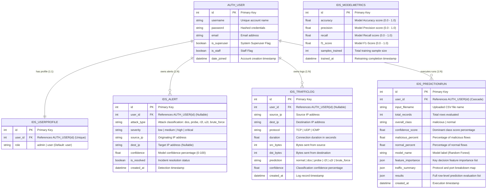

# NetSentinel AI — Role Feature Analysis & UML Architecture Documentation

**System:** NetSentinel AI (AI-Powered Intrusion Detection System)  
**Version:** 1.1.0 (Production Architecture — User & Administrator Roles)  
**Stack:** Python 3.11/3.14, Django 4.2+, Scikit-Learn, Joblib, SQLite3, Wireshark/TShark, Chart.js  

---

## 1. Feature Analysis by Role

NetSentinel AI implements Role-Based Access Control (RBAC) with data isolation via `RoleAccessMiddleware` and object-level filtering (`_owned(queryset, user)`).

### 1.1 Actor Definitions

1. **Public / Anonymous User**: Unauthenticated visitors accessing public landing and onboarding portals.
2. **User (Standard User / Security Analyst)**: Authenticated operational user conducting packet inspection, running batch evaluations, triaging alerts, managing their personal workspace preferences/settings, and analyzing localized threat telemetry.
3. **Administrator (SOC Lead / System Admin)**: SOC oversight role possessing global visibility across all system tenants, user management authority, model retraining permissions, and testing governance.

---

### 1.2 Role-Based Feature Matrix

| Functional Module | Feature / Capability | Route / Endpoint | Anonymous | User | Administrator | Scope / Access Rules |
| :--- | :--- | :--- | :---: | :---: | :---: | :--- |
| **Authentication & Profile** | View Landing Page | `/` | Read | Read | Read | Public |
| | User Registration | `/register/` | Create | — | — | Default role assigned: `user` |
| | User Login / Logout | `/login/`, `/logout/` | Execute | Execute | Execute | Session authentication |
| **Workspace & Dashboard** | User Workspace | `/dashboard/` | — | Read | — | View own alerts, logs, prediction runs |
| | Admin Global SOC Overview | `/dashboard/` | — | — | Read | Global aggregated metrics & user activity |
| | Telemetry Chart API | `/api/charts/` | — | Read (Own) | Read (Global) | 24h trends, protocol shares, severity splits |
| **Traffic Monitoring** | Interface Status & Sniffing | `/monitor/` | — | Read | Read | Discovers Wireshark / TShark interfaces |
| | Live Packet Capture | `/api/capture/` | — | Execute | Execute | Sniffs network adapter, extracts 41 features |
| | Synthetic Traffic Simulation | `/api/simulate/` | — | Execute | Execute | Fallback packet generator with ML scoring |
| **Batch Prediction** | Upload CSV Dataset | `/upload-dataset/` | — | Create | Create | Validates & scores multi-flow CSV records |
| | Interactive Prediction Results | `/predict/result/<pk>/`| — | Read (Own) | Read (Global) | Flow summary, dominant class, feature import. |
| | Download Scored Predictions | `/predict/download/<pk>/` | — | Read (Own) | Read (Global) | Generates enriched CSV attachment |
| | Dataset Run History | `/dataset-history/` | — | Read (Own) | Read (Global) | Historical prediction batch audit logs |
| **Threat Management** | Security Alert Listing | `/alerts/` | — | Read (Own) | Read (Global) | Filter by severity: Low, Medium, High, Critical |
| | Resolve Security Alert | `/alerts/<pk>/resolve/`| — | Execute (Own)| Execute (Any) | Marks `is_resolved=True` |
| | Traffic Audit Logs | `/logs/` | — | Read (Own) | Read (Global) | Tabular packet headers, payloads & confidence |
| **Analytics & Reporting** | Incident Analytics Reports | `/reports/` | — | Read (Own) | Read (Global) | 7-day attack distribution, resolution KPI |
| **Settings & Preferences** | Account & Workspace Settings | `/settings/` | — | Read/Write | Read/Write | Theme toggle, user profile, role permissions |
| **Model Operations** | View Model Metrics | `/train/` | — | Read | Read | View Accuracy, Precision, Recall, F1-Score |
| | Retrain Random Forest Model| `/train/run/` | — | Blocked (403)| Execute | Asynchronous background retraining worker |
| **Administration** | User & Role Management | `/users/` | — | Blocked (403)| CRUD | Role promotion/demotion with safety guardrails |
| | Automated Test Suite Run | `/test-results/` | — | Blocked (403)| Read/Execute | Runs live regression tests TC-01 to TC-10 |
| | Download Test Run Report | `/test-results/download/` | — | Blocked (403)| Download | Exports markdown report artifact |

---

## 2. UML Use Case Diagram

The Use Case Diagram models the system boundaries, human actors, external hardware/packet capture subsystems, and their interactions.

```mermaid
usecaseDiagram
    actor "Anonymous User" as Anon
    actor "User" as RegUser
    actor "Administrator" as Admin
    actor "Network Adapter / TShark" as Sniffer

    package "NetSentinel AI Security Platform" {
        usecase "UC-01: Authenticate / Register" as UC_Auth
        usecase "UC-02: View Workspace Dashboard" as UC_Dash
        usecase "UC-03: Sniff Live Traffic" as UC_Sniff
        usecase "UC-04: Simulate Network Traffic" as UC_Sim
        usecase "UC-05: Upload Dataset for Batch Scoring" as UC_Upload
        usecase "UC-06: Inspect Prediction Results" as UC_Result
        usecase "UC-07: Export Scored CSV" as UC_Export
        usecase "UC-08: Triage & Resolve Alerts" as UC_Alerts
        usecase "UC-09: Explore Traffic Logs" as UC_Logs
        usecase "UC-10: Review Threat Analytics Reports" as UC_Reports
        usecase "UC-11: Manage Workspace Settings" as UC_Settings
        usecase "UC-12: Supervise Global SOC Operations" as UC_AdminDash
        usecase "UC-13: Manage User Roles & Permissions" as UC_Users
        usecase "UC-14: Retrain Random Forest AI Model" as UC_Train
        usecase "UC-15: Execute End-to-End Test Suite" as UC_Tests
        usecase "UC-16: Feature Vector Extraction (41 Dims)" as UC_Feat
        usecase "UC-17: Execute ML Threat Inference" as UC_Infer
    }

    %% Relationships for Anonymous
    Anon --> UC_Auth

    %% Relationships for User
    RegUser --> UC_Auth
    RegUser --> UC_Dash
    RegUser --> UC_Sniff
    RegUser --> UC_Sim
    RegUser --> UC_Upload
    RegUser --> UC_Result
    RegUser --> UC_Export
    RegUser --> UC_Alerts
    RegUser --> UC_Logs
    RegUser --> UC_Reports
    RegUser --> UC_Settings

    %% Inheritance / Extended access for Admin
    Admin --|> RegUser
    Admin --> UC_AdminDash
    Admin --> UC_Users
    Admin --> UC_Train
    Admin --> UC_Tests

    %% System and Subsystem Includes
    UC_Sniff ..> UC_Feat : <<include>>
    UC_Sim ..> UC_Feat : <<include>>
    UC_Upload ..> UC_Feat : <<include>>
    UC_Feat ..> UC_Infer : <<include>>

    %% Sniffer hardware interaction
    Sniffer --> UC_Sniff
```

---

## 3. System Architecture Diagram

NetSentinel AI employs a 4-Tier Modular Layered Architecture separating presentation, application logic/RBAC, machine learning pipelines, and persistence/hardware integration.



---

## 4. Data Flow Diagrams (DFD)

### 4.1 DFD Level 0 — Context Diagram

The Context Diagram defines the external entities interacting with the NetSentinel AI system and the boundaries of data entering and leaving the system.



---

### 4.2 DFD Level 1 — Detailed Process Decomposition

DFD Level 1 decomposes the central system into 7 core processes, showing data stores and data paths.

```mermaid
flowchart TB
    %% External Entities
    User(["User / Admin"])
    Hardware(["Network Interface"])
    FileIn(["CSV File"])

    %% Data Stores
    subgraph Data_Stores ["Data Stores"]
        DS1[("DS-1: User Profiles & Roles")]
        DS2[("DS-2: Traffic Logs")]
        DS3[("DS-3: Security Alerts")]
        DS4[("DS-4: Prediction Runs")]
        DS5[("DS-5: Model Weights & Metrics")]
    end

    %% Subprocesses
    P1["1.0 Authentication & RBAC Enforcement"]
    P2["2.0 Live Packet Capture & Simulation"]
    P3["3.0 Batch CSV Dataset Ingestion"]
    P4["4.0 ML Feature Normalization & Inference"]
    P5["5.0 Alert & Log Persistence Engine"]
    P6["6.0 Model Retraining Worker"]
    P7["7.0 Telemetry, Reporting & Settings Engine"]

    %% Data Flows P1
    User -->|Login / Registration| P1
    P1 <-->|Validate Credentials & Roles (admin/user)| DS1
    P1 -->|Authorized Session Context| P2
    P1 -->|Authorized Session Context| P3
    P1 -->|Authorized Session Context| P7

    %% Data Flows P2
    Hardware -->|Raw Packets| P2
    P2 -->|Simulated/Extracted Flow| P4

    %% Data Flows P3
    FileIn -->|CSV Rows| P3
    P3 -->|Normalized Connection Rows| P4

    %% Data Flows P4
    P4 <-->|Ensemble Weights & Encoders| DS5
    P4 -->|Multi-Class Labels & Confidences| P5
    P4 -->|Batch Analysis Summary| DS4

    %% Data Flows P5
    P5 -->|Insert Network Flows| DS2
    P5 -->|Insert Malicious Intrusion Events| DS3

    %% Data Flows P6
    User -->|Trigger Retraining (Admin Only)| P6
    DS2 -->|Historical Network Traffic Corpus| P6
    P6 -->|Write Updated Model & Metrics| DS5

    %% Data Flows P7
    DS1 -->|User Profile & Account Info| P7
    DS2 -->|Read Traffic Logs| P7
    DS3 -->|Read Security Alerts| P7
    DS4 -->|Read Prediction Runs| P7
    DS5 -->|Read Model Accuracy| P7
    P7 -->|Role-Filtered Dashboards, Settings & Reports| User
```

---

## 5. UML Component Diagram

The Component Diagram details the internal components, their interfaces, dependencies, and execution boundaries.

```mermaid
graph TB
    subgraph Client_Component ["Web Interface Component"]
        [TemplateViews]
        [ChartRenderer]
        [UploadHandler]
        [SettingsManager]
    end

    subgraph Security_Gate ["Security & RBAC Component"]
        [RoleAccessMiddleware]
        [AuthBackend]
    end

    subgraph Controller_Component ["Django Application Controllers"]
        [DashboardController]
        [MonitorController]
        [BatchPredictController]
        [AlertLogController]
        [SettingsController]
        [AdminOpsController]
    end

    subgraph Domain_ML_Component ["Intrusion Detection Core (ML Component)"]
        [PacketDissector]
        [DatasetNormalizer]
        [RandomForestClassifier]
        [ModelRetrainer]
    end

    subgraph Ingestion_Hardware ["External Ingestion Component"]
        [TSharkSubprocessAdapter]
    end

    subgraph Data_Access_Component ["Django ORM & Storage"]
        [ORM_AlertModel]
        [ORM_TrafficLogModel]
        [ORM_PredictionRunModel]
        [ORM_ModelMetricsModel]
        [ORM_UserProfileModel]
        [JoblibSerializer]
    end

    %% Bindings & Interfaces
    Client_Component -->|HTTP Request| [RoleAccessMiddleware]
    [RoleAccessMiddleware] --> [AuthBackend]
    [RoleAccessMiddleware] --> Controller_Component

    [MonitorController] --> [TSharkSubprocessAdapter]
    [TSharkSubprocessAdapter] --> [PacketDissector]
    [PacketDissector] --> [RandomForestClassifier]

    [BatchPredictController] --> [DatasetNormalizer]
    [DatasetNormalizer] --> [RandomForestClassifier]

    [AdminOpsController] --> [ModelRetrainer]
    [ModelRetrainer] --> [JoblibSerializer]
    [RandomForestClassifier] --> [JoblibSerializer]

    Controller_Component --> Data_Access_Component
    [ModelRetrainer] --> [ORM_TrafficLogModel]
```

---

## 6. Entity-Relationship Diagram (ERD)

The relational schema is implemented in SQLite using Django's ORM. It establishes data ownership by associating logs, alerts, and prediction runs with user accounts.



---

## 7. Data Dictionary & Relationship Specifications

| Parent Entity | Child Entity | Cardinality | Constraint / On Delete | Business Rule |
| :--- | :--- | :---: | :---: | :--- |
| `auth_user` | `ids_userprofile` | `1 : 1` | `CASCADE` | Every user has exactly one profile record holding their system role (`admin` or `user`). Created automatically on registration. |
| `auth_user` | `ids_alert` | `1 : N` | `SET_NULL` | Alerts generated during live sniffing or batch runs are attributed to the initiating analyst. Admin views see all alerts; Users see only owned alerts. |
| `auth_user` | `ids_trafficlog` | `1 : N` | `SET_NULL` | High-frequency flow logs are attributed to the active session user. Retraining pipelines ingest these logs to continuously adapt the ML model. |
| `auth_user` | `ids_predictionrun`| `1 : N` | `CASCADE` | Represents batch CSV scoring jobs. When a user account is deleted, their uploaded batch runs and cached evaluations are deleted. |
| *(None)* | `ids_modelmetrics` | Standalone | N/A | Immutable time-series audit trail of model performance recorded after every initial setup or background retraining run. |

---

## 8. Summary of Architectural Attributes

1. **Security & Principle of Least Privilege:**
   - Standard Users cannot promote accounts, trigger background retraining tasks, or execute system test suites.
   - Guardrails enforce that the last remaining administrator account cannot be demoted, and superusers always retain administrator capabilities.
2. **Access to Workspace Settings:**
   - Both Users and Administrators have direct access to `/settings/`. The settings dashboard automatically tailors available options based on role permissions (account profile and theme toggling for Users; system-level paths, user management, and retraining shortcuts for Administrators).
3. **Resilience & Graceful Degradation:**
   - If hardware packet sniffing (`tshark`) is unavailable in the environment, the system provides a continuous fallback traffic simulator with complete 41-feature NSL-KDD synthesis.
4. **Decoupled Asynchronous Retraining:**
   - Model retraining executes in a background thread to prevent HTTP worker starvation, serializing new weights directly to disk via `joblib`.
